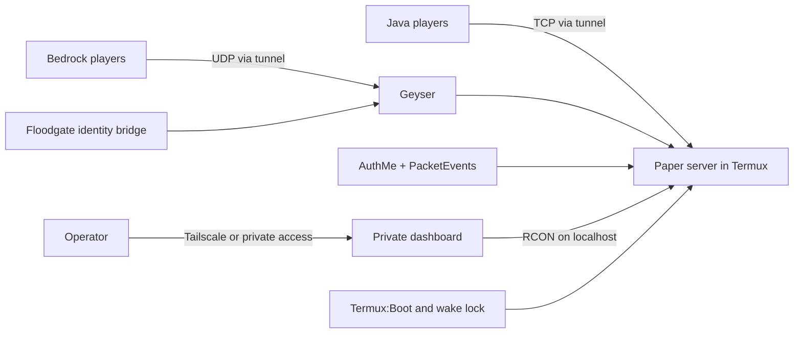

# Minecraft on an Old Phone

[](LICENSE) [](#requirements) [](#roadmap)

A beginner-friendly guide and companion scripts for running a small, always-on Minecraft server on an older Android phone with Termux. The target setup supports Java and Bedrock players, account authentication, remote access through a tunnel, and a private web dashboard.

> **Project status:** Termux SSH and OpenJDK 21 are verified on the target phone. Paper 1.21.11 starts with a 1.5 GiB heap cap, 6-chunk view and simulation distances, and a six-player limit. Geyser, Floodgate, ViaVersion, AuthMe 6.0.1, and PacketEvents 2.14.0 have loaded. Offline mode and whitelist enforcement are enabled, and the Java port is reachable from the setup computer on the local network; actual player login flows remain untested. Termux:Boot and a guarded wake-lock/startup script are installed, but an Android reboot test and power/thermal checks remain. Bedrock client connections and upcoming NetherNet compatibility are also unverified. See the [authentication guide](docs/04-auth-cracked-premium.md), [24/7 reliability guide](docs/05-24-7-reliability.md), [Bedrock guide](docs/03-bedrock-geyser.md), and [troubleshooting page](docs/troubleshooting.md).

## Architecture



## Features

| Feature | Planned implementation | Status |
|---|---|---|
| Android server | Termux and OpenJDK 21 | 🟡 In progress |
| Lightweight Java server | PaperMC with conservative memory and view distance | 🟡 In progress |
| Bedrock connectivity | Geyser, Floodgate, and ViaVersion | 🟡 In progress |
| Premium and offline Java accounts | AuthMe premium bypass and PacketEvents, with whitelist | 🟡 In progress |
| Reliability | Termux:Boot, wake lock, battery and thermal guidance | 🟡 In progress |
| Internet connectivity | TCP/UDP tunnel suitable for CGNAT | ⬜ Planned |
| Private controls | Small dashboard using local RCON | ⬜ Planned |
| Backups | User-controlled backup scripts | ⬜ Planned |

Status key: ✅ Done and verified · 🟡 In progress · ⬜ Planned

## Requirements

- An Android phone with enough free storage and reliable power; the initial target is an OPPO A57 with 4 GB RAM.
- Termux installed from F-Droid (avoid the outdated Play Store build).
- A separate Termux:Boot app for startup automation.
- A computer with SSH client access to the phone on Termux's SSH port (usually `8022`).
- Git and GitHub CLI (`gh`) for contributing or publishing this repository.
- Java players use a compatible Minecraft Java Edition client. Bedrock players use a compatible Bedrock client.

This setup is intended for a small private community. A 4 GB phone has limited CPU, memory, storage, cooling, and battery capacity; actual player capacity depends on the world and device condition.

## Quick start

The detailed process is split into verified phases. Start with [Termux setup](docs/01-termux-setup.md), then follow each phase in order. Do not paste secrets into commands that may be saved in shell history.

```text
1. Prepare and verify Termux and Java
2. Install and tune Paper
3. Add Geyser and Floodgate
4. Configure Java authentication and whitelist
5. Configure reliable, thermally safe operation
6. Set up private tunnel access
7. Configure the private dashboard
```

No command below should be treated as verified until it is tested and recorded in the matching guide.

## Roadmap

| Phase | Guide | Status |
|---|---|---|
| 1. Termux and Java | [01-termux-setup.md](docs/01-termux-setup.md) | 🟡 In progress |
| 2. PaperMC | [02-papermc.md](docs/02-papermc.md) | 🟡 In progress |
| 3. Bedrock with Geyser | [03-bedrock-geyser.md](docs/03-bedrock-geyser.md) | 🟡 In progress |
| 4. Cracked and premium Java access | [04-auth-cracked-premium.md](docs/04-auth-cracked-premium.md) | 🟡 In progress |
| 5. 24/7 reliability | [05-24-7-reliability.md](docs/05-24-7-reliability.md) | 🟡 In progress |
| 6. Tunnel access | [06-tunnel-access.md](docs/06-tunnel-access.md) | ⬜ Planned |
| 7. Dashboard | [07-dashboard.md](docs/07-dashboard.md) | ⬜ Planned |

See [troubleshooting](docs/troubleshooting.md) for verified errors and fixes and [security](docs/security.md) for security practices.

## Security notes

- Never expose RCON or the dashboard directly to the public internet. Keep RCON bound to localhost and restrict dashboard access through a private network such as Tailscale.
- Never commit passwords, tokens, SSH keys, tunnel credentials, server data, player data, or logs. Use the sanitized files in `config-examples/` and keep real configuration on the phone.
- Offline-mode Java servers cannot verify ownership of Java account names. Use a trusted authentication plugin, strong unique passwords, and a whitelist; understand the trade-offs before allowing offline accounts.
- Review every command before running it. Keep backups outside the active world directory and verify that they can be restored.

## Contributing

See [CONTRIBUTING.md](CONTRIBUTING.md). Report reproducible device-specific issues with Android version, Termux package versions, and redacted logs. Remove IP addresses, UUIDs, usernames, and secrets from reports.

## Credits

- [PaperMC](https://papermc.io/) for the server software.
- [GeyserMC](https://geysermc.org/) for Java/Bedrock connectivity and Floodgate.
- [AuthMeReloaded](https://github.com/AuthMe/AuthMeReloaded) for password authentication and premium bypass.
- [PacketEvents](https://github.com/retrooper/packetevents) for AuthMe's offline-mode premium verification.
- Termux and its community for Android terminal tools.
- Plugin and tunnel projects will be credited in the corresponding guides after their versions and configuration are verified.

## License

This project is licensed under the [MIT License](LICENSE).
